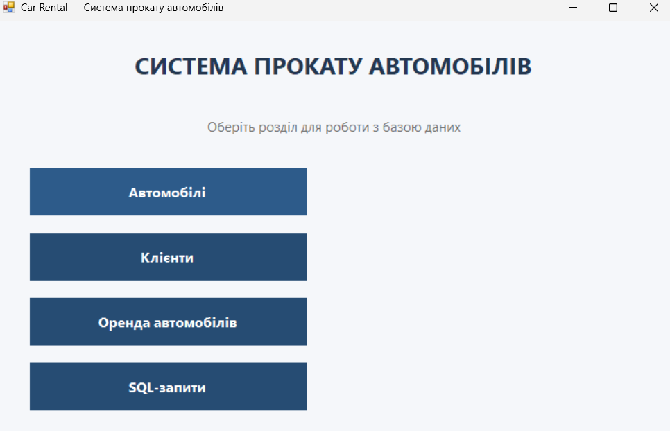
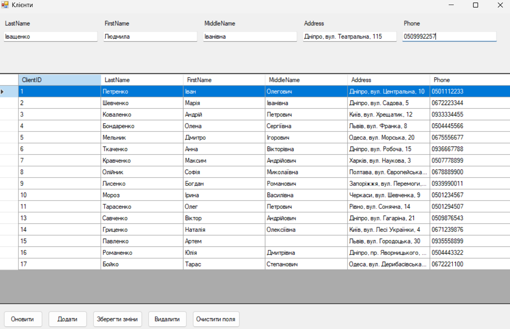
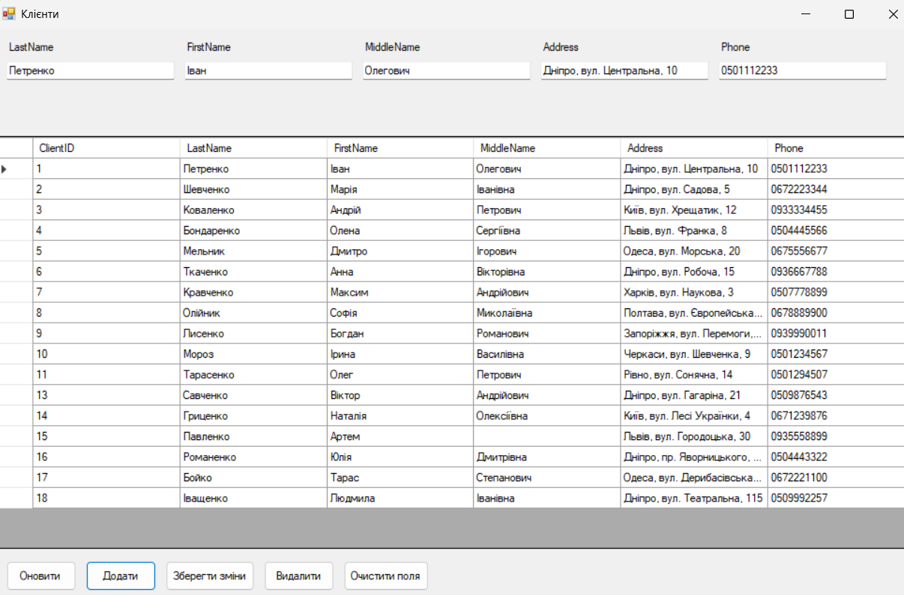
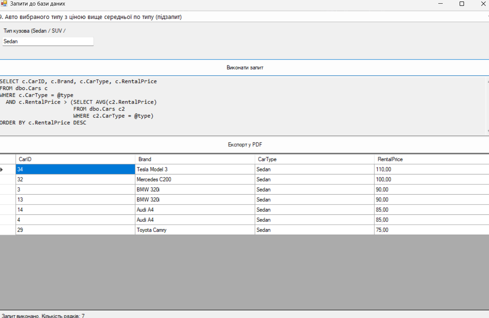
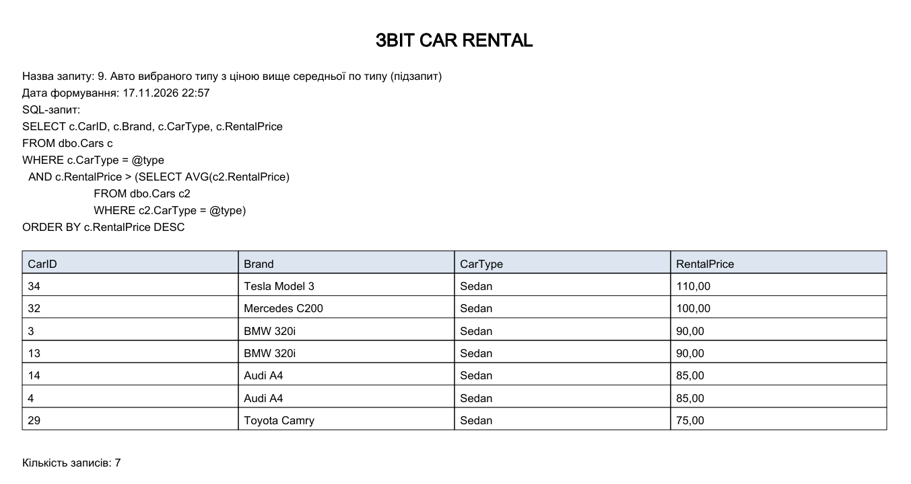

# CarRentalApp

CarRentalApp is a desktop application for managing a car rental service. The project is developed using C#, Windows Forms and Microsoft SQL Server.

## About the Project

The application is designed to make working with car rental data easier. It allows users to manage database records and work with information through a graphical interface.

The project also includes SQL queries for retrieving and working with data from the database.

## Technologies

- C#
- Windows Forms
- Microsoft SQL Server
- ADO.NET
- Microsoft.Data.SqlClient
- Visual Studio

## Main Features

- Connecting the application to a SQL Server database.
- Adding, editing and deleting records.
- Viewing information from database tables.
- Searching and filtering data.
- Executing SQL queries.
- Working with data from multiple tables.
- Generating PDF reports.

## Database

The application uses a database called `CarRentalDB`.
The connection to the database is implemented using `Microsoft.Data.SqlClient`.

## Screenshots

### Main Window

### Database Management

### Adding a Record

### SQL Queries

### PDF Report

